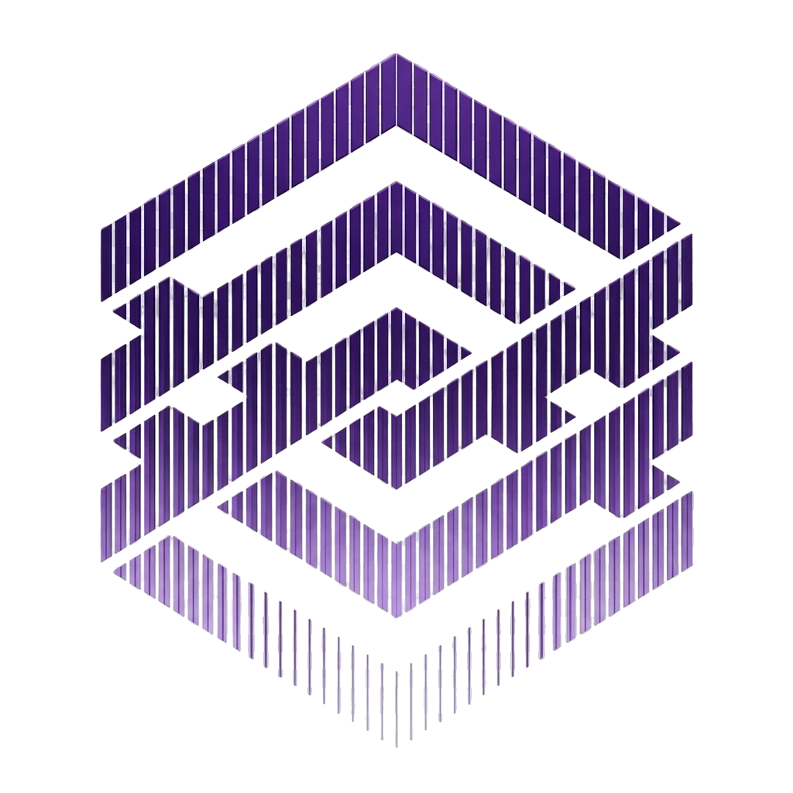

<div align="center">



# ⚡ NIGHTSHIFT

**A desktop workbench for command-line tools.**

Pick the tools you need, run them through visual forms or raw commands, save what you do as templates, and batch it across files.

*Built with Tauri v2, Next.js, Redux Toolkit, and a native Rust execution engine.*

[](https://github.com/Chamith-Dilshan/NightShift/releases)
[](LICENSE)
[](https://v2.tauri.app)
[](https://www.rust-lang.org)
[](https://nextjs.org)
[](https://github.com/Chamith-Dilshan/NightShift/releases)

[**Overview**](#-overview) • [**Status**](#-status) • [**Features**](#-features-today) • [**Quick Start**](#-quick-start) • [**Tools**](#-tools-are-never-bundled) • [**Roadmap**](#-roadmap) • [**Contributing**](CONTRIBUTING.md) • [**Security**](SECURITY.md)

</div>

---

## 🌌 Overview

Command-line tools are some of the most powerful software around, but their options are scattered, easy to forget, and awkward to reuse. **NightShift gives them one home.**

1. **Pick** the tools you want. NightShift helps you install or locate them.
2. **Configure** them through a visual form, or write the command yourself. The exact command is always visible and editable.
3. **Run** with live logs, progress, cancel, and clear errors.
4. **Save** a configuration as a reusable template.
5. **Batch** it across many files.

NightShift is **not** a graphical editor and has no media preview. It builds and runs commands; it does not hide them.

**FFmpeg is the first tool**, and it is an example, not the identity of the project. NightShift is being built as a platform where each tool is described by a declarative spec, so more tools can be added without rewriting the app (see the [roadmap](#-roadmap)).

```
┌──────────────────────────────────────────────────────────────────────────┐
│                               NIGHTSHIFT                                 │
│                                                                          │
│   Tool  ──>  Visual form / raw command  ──>  Exact command preview       │
│                         │                            │                   │
│                  Validated settings          Native Rust runner          │
│                         │                    (no shell, argv only)       │
│                         ▼                            ▼                   │
│               Templates · Batch  <───  Live logs · progress · exit code  │
└──────────────────────────────────────────────────────────────────────────┘
```

---

## 📍 Status

| | |
|---|---|
| **Released** | **v0.2**, the platform core (tool specs, tool catalog, libvips, shareable templates, folder batches) |
| **Not yet available** | Anything listed under [Roadmap](#-roadmap) as planned |

---

## ✨ Features

### 🧰 Tool Catalog

- **Browse tools:** see all available tools with status badges — installed, detected on your system, or missing.
- **Install or locate:** for each tool you can use a managed download (SHA-256 verified), detect an existing system install, or point to an executable yourself.
- **Custom tools:** add any CLI executable as a custom tool with a raw-command workbench.
- **Bundled tools:** **FFmpeg** (video/audio) and **libvips** (image processing) ship as first-class tools with full parameter panels.

### 📋 Spec Engine

- **Declarative tool specs:** each tool is described by a JSON spec — binaries, commands, parameters, validation rules, argument templates, and progress parsers.
- **Auto-generated forms:** parameter panels are generated from the spec, so new tools ship without writing UI code.
- **Expression language:** conditional visibility, enabled states, and value mapping — no `eval`, no dynamic code.
- **Pure TypeScript core:** `src/core/` contains no React, Redux, or Tauri dependencies, making it reusable in a future headless CLI.

### 📄 Templates

- **Save and reuse:** any tool configuration (visual form or raw command) can be saved as a template.
- **Shareable files:** export templates as `.nightshift-template.json` files or packs (`.nightshift-pack.json`).
- **Import with review:** before saving, a review screen shows required tools, mode, resolved command preview, and security warnings.
- **Path safety:** file paths are stripped on export and recorded as gaps; the importer chooses local files.
- **Library management:** search, filter by tool, tag, duplicate, rename, delete, and apply templates.
- **Built-in presets:** four FFmpeg presets (web MP4, web WebM, scroll-scrub, small GIF) ship as read-only templates.

### 📦 Batch Processing

- **Folder and file inputs:** select individual files or entire folders as batch inputs.
- **Output options:** choose output directory, flat or mirrored structure, name patterns (`{name}`, `{index}`, `{ext}`, `{parent}`, `{date}`), and conflict policy (rename, overwrite, skip).
- **Dry-run plan:** review a table of all planned jobs with input/output paths before running.
- **Concurrency:** run jobs in parallel (default 1, up to logical cores).
- **Failure policy:** continue on failure or stop at the first error.
- **Summary:** on completion see counts, wall time, bytes before/after, and per-failure error lines.

### 🎬 FFmpeg Video Tool

FFmpeg is the first tool on the platform, with a rich built-in panel:

- **Containers:** MP4, WebM, GIF and custom output targets, with codec compatibility handled for you.
- **Per-codec rules:** H.264, H.265, VP9, and AV1 each get the right rate control, speed and pixel-format arguments.
- **Trim, crop, keyframes, filters, transforms, watermark** — all v0.1 features remain unchanged.
- **Encoder detection:** checks your FFmpeg build and disables codecs it does not include.

### ⚡ Command Generation

- **Deterministic:** command arguments are built by a pure function from your settings, with no UI side effects.
- **Visible and editable:** the live command preview can be copied or edited by hand (manual mode), then reset back to the form.
- **Validation before running:** invalid combinations are blocked with an explanation.
- **Live logs:** structured progress, speed and timecode from the native runner, correct exit codes, and cancel.

### 🔒 Security

- **No shell:** commands are executed as argv arrays, never through a shell.
- **No bundled binaries:** tools are downloaded (SHA-256 verified), detected, or user-pointed — never redistributed.
- **Template review:** imported templates are reviewed before saving; raw mode, URL schemes, and absolute paths trigger warnings.
- **File size limits:** templates ≤ 1 MB, packs ≤ 200 templates, argv tokens ≤ 10,000.

---

## 🎬 Demo

[](https://github.com/Chamith-Dilshan/NightShift/raw/main/.github/assets/demo.mp4)

*A short walkthrough of the current FFmpeg tool.*

---

## 🧰 Tools are never bundled

NightShift does **not** ship tool binaries inside its installer. This keeps the download small and avoids redistributing other projects' software.

- **Tool catalog:** browse available tools and choose which ones to install. For each tool you can use a managed download (SHA-256 verified), detect an existing system install, or point to an executable yourself.
- **Custom tools:** add any CLI executable as a custom tool. It gets a raw-command workbench and works with templates and batch.
- **Install hints:** where no managed download exists (e.g., libvips on macOS/Linux), NightShift shows copyable install commands for your platform's package manager.

Tools you install keep their own licenses. See [THIRD_PARTY_NOTICES.md](THIRD_PARTY_NOTICES.md).

---

## 🚀 Quick Start

### 1. Download an installer

Packages are published on [GitHub Releases](https://github.com/Chamith-Dilshan/NightShift/releases):

| OS | Package | Link |
|---|---|---|
| **Windows** | NSIS installer (`.exe`) | [Latest release](https://github.com/Chamith-Dilshan/NightShift/releases/latest) |
| **macOS** | Disk image (`.dmg`) | [Latest release](https://github.com/Chamith-Dilshan/NightShift/releases/latest) |
| **Linux** | AppImage / `.deb` | [Latest release](https://github.com/Chamith-Dilshan/NightShift/releases/latest) |

**🔓 Opening unsigned builds**

Current builds are not code-signed:

- **Windows:** if SmartScreen appears, click **More info → Run anyway**.
- **macOS:** right-click `NightShift.app` and choose **Open**, or allow it under **System Settings → Privacy & Security → Open Anyway**, or run:

  ```bash
  xattr -cr /Applications/NightShift.app
  ```

- **Linux:** make the AppImage executable: `chmod +x NightShift-*.AppImage`

### 2. Build from source

**Prerequisites**

- Node.js `v24+` and pnpm `v12+`
- Rust (`stable`; run `rustup update stable`)
- Platform build tools (Visual Studio 2022 C++ tools on Windows, Xcode Command Line Tools on macOS, WebKitGTK dependencies on Linux; see the [Tauri prerequisites](https://v2.tauri.app/start/prerequisites/))

**Steps**

```bash
git clone https://github.com/Chamith-Dilshan/NightShift.git
cd NightShift
pnpm install

pnpm tauri dev   # desktop app in development mode
pnpm tauri build   # build the desktop app
pnpm dev         # (optional) UI in a plain browser with a mock executor
```

**Checks**

```bash
pnpm lint
pnpm typecheck
pnpm  test
cargo fmt --manifest-path src-tauri/Cargo.toml --check
cargo clippy --manifest-path src-tauri/Cargo.toml -- -D warnings
cargo test --manifest-path src-tauri/Cargo.toml
```

---

## 🏗️ Architecture

NightShift is a **platform for CLI tools**. Each tool is described by a declarative JSON spec, and the app generates forms, builds commands, and runs them through a native Rust engine.

```
┌───────────────────────────────────────────────────────────────────────────┐
│ UI (Next.js client components)                                            │
│  Home/Catalog · Tool workbench (SpecPanel | builtin panel) · Templates    │
│  Batch panel · Queue/Terminal · Settings                                  │
├───────────────────────────────────────────────────────────────────────────┤
│ Redux: workbenchSlice (generic) · videoSlice (ffmpeg, unchanged)          │
│        templatesSlice · jobsSlice · batchesSlice · toolsSlice             │
├───────────────────────────────────────────────────────────────────────────┤
│ src/core  (PURE TypeScript, no React/Redux/Tauri)                         │
│  spec/{schema, argBuilder, expr, versions}                                │
│  template/{schema, io, review, variables}                                 │
│  batch/{naming, plan}                                                     │
├───────────────────────────────────────────────────────────────────────────┤
│ Executor (Tauri | Mock)                                                   │
├───────────────────────────────────────────────────────────────────────────┤
│ Rust: spec loader · tool registry · run_job/cancel_job · probe            │
│       expand_inputs · check_paths · settings v2 · install pipeline        │
└─────────────────────────┬─────────────────────────────────────────────────┘
                          │ spawn (argv, no shell)
              ┌───────────▼───────────┐ ┌──────────────┐ ┌───────────────┐
              │ ffmpeg/ffprobe        │ │ vips family  │ │ user.<tool>   │ …
              └───────────────────────┘ └──────────────┘ └───────────────┘
```

- **Tauri v2 (Rust)** hosts the app and owns process execution: no shell, argument arrays only, structured progress parsing, cancel, and tool management.
- **Next.js (static export)** renders the UI.
- **Redux Toolkit** holds state; a pure spec engine builds commands from parameters.
- **`src/core/` is pure TypeScript:** no React, Redux, or Tauri — reusable in a future headless CLI.
- **No local web server and no sidecar.** The frontend never supplies an executable path; Rust resolves tools.

Details live in [APP_ARCHITECTURE.md](APP_ARCHITECTURE.md). Long-term direction and decisions are in [PROJECT_BIBLE.md](PROJECT_BIBLE.md).

---

## 🗺️ Roadmap

**Done**
- [x] **v0.1:** native Rust runner, FFmpeg video tool, tool manager, sequential queue, templates, installers.
- [x] **v0.2, platform core:** declarative tool specs, tool catalog, custom tools, **libvips** as the second tool, shareable templates with import security, batch processing with dry-run plans, workflow design document.

**Planned**
- [ ] **v0.3, workflows:** chain several tools into reusable workflows (multi-node DAGs), with typed ports, caching, partial reruns, and a headless command-line runner (`nightshift run`). Design: [docs/WORKFLOWS_DESIGN.md](docs/WORKFLOWS_DESIGN.md).
- [ ] **v0.4, editor and extensions:** visual workflow editor, interactive terminal, optional extensions for tools that need other runtimes.
- [ ] **Later:** more tools (audio, document, and forensic tools), a template/spec registry with signed packages, and optional AI-assisted command building with your own keys or local models.

**FFmpeg tool backlog:** two-pass VBR encoding, HDR-to-SDR tone mapping, hardware encoders and decoders (`nvenc`, `qsv`, `vaapi`, `videotoolbox`).

The roadmap is a plan, not a promise. Priorities shift with feedback, so open an issue to tell us what you would use NightShift for.

---

## 🤝 Contributing

Contributions are welcome. See [CONTRIBUTING.md](CONTRIBUTING.md) for setup, branch conventions, coding guidelines, and the pull request process.

## 🔒 Security

For vulnerability reports and the local-first threat model, see [SECURITY.md](SECURITY.md).

## 📄 License, trademark and third-party notices

NightShift's source code is released under the [Apache License 2.0](LICENSE). FFmpeg and other tools are downloaded or detected on your machine, are not distributed with NightShift, and remain under their own licenses. See [THIRD_PARTY_NOTICES.md](THIRD_PARTY_NOTICES.md).

---

<div align="center">

Made for people who live in the terminal and are tired of remembering the flags. ⚡

</div>